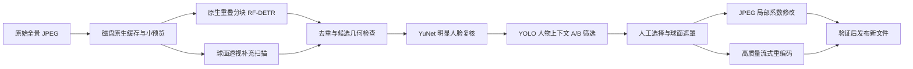

# 原理与代码结构

## 总体数据流

## 1. 读图和坐标

`photo_engine.prepare_photo` 通过 libvips 解码 JPEG，一次生成可随机访问的磁盘 `.v` 缓存和不超过 2048×1024 的预览。NumPy 只持有局部视图或分块，避免为十亿像素照片创建完整 RGB/遮罩数组。

区域使用两种坐标：ERP 中归一化的经纬展开矩形，或者记录了 yaw/pitch/fov/roll、视图尺寸和归一化脸框的透视区域。ERP 水平方向允许跨越 0/1 接缝。几何采用像素中心约定，水平周期延伸，垂直边界钳制。

`geometry.region_membership` 是球面射线是否落入遮罩的公共判断。原生导出与高清透视预览复用这套规则。椭圆、圆形在记录的透视平面定义；小 ERP 框转换到局部切平面，跨越摄像机半球的大 ERP 区域采用角度坐标的形状规则。圆形按像素比例定义，避免长宽不同的视口使它变成椭圆。

## 2. 人脸候选生成

主模型是 RF-DETR Medium Face 的 ONNX 导出，固定 FP32 输入 `1×3×576×576`，RGB 使用 ImageNet 均值/标准差归一化。输出 300 个归一化 cx/cy/w/h 和单类 logits，sigmoid 后按阈值筛选。

原图按 576 像素块、448 像素步长扫描，包含水平接缝补块。还在多个经度、俯仰 -60/0/60 度和两个极区生成 1536×1536 透视图，再分块检测，减少展开图畸变的影响。

默认 obvious 模式阈值 0.60、原生短边至少 24 像素；more 模式阈值 0.40、短边至少 16 像素。异常巨框或极端长宽比默认不勾选。去重同时考虑接缝偏移和透视投影，并保留不同复核状态的候选。

默认模式使用 YuNet 对局部 320 像素视图再次核实。不确认的候选会取消默认勾选，但保留，允许用户恢复。更多候选模式不执行同样的 YuNet 默认复核。

## 3. 人物上下文筛选

YOLOv8n COCO ONNX 以 640×640 RGB FP32 推理，只使用 person 类。它不识别人脸身份，也不生成生物识别向量。解码采用最佳类别选择、置信度下限 0.05 和 IoU 0.5 NMS。

对于每个脸框，A 视角扩大到脸部角跨度约 9 倍，并向下偏移 2.5 倍跨度，以纳入身体。B 使用约 14 倍视野和 4 倍向下偏移。A/B 最小视野分别为 3/5 度，最大 100 度。只有 A 保留且未通过 YuNet 确认的候选才执行 B。

不能只判断裁剪里有没有人，否则旁边路人也会让错误脸框通过。关联要求候选至少 60% 位于人物框内，中心横向在人物框 -5% 至105% 范围、纵向在 -8% 至42% 范围，候选高度不超过人物框高度的65%；关联得分至少0.25。

结果记录 `context_keep/context_reason`，全部候选仍返回。疑似背景自动取消勾选并默认隐藏，手动区域保留。过滤模型不可用时明确标记并保留可见候选，而不是把失败当成背景证据。

## 4. GPU 与 RAM 调度

每个 RF-DETR ONNX 会话有自己的锁，不能靠多个线程同时调用同一会话来获得这里的并发。程序创建独立 CUDA 会话，尝试1/2/4/8路，在实时资源预算内比较同一批至少128块的完整处理吞吐。相邻增益不足10%停止升级，接近阈值时复测；同时检查检测结果和原始输出一致性。

通过 psutil 读取 RAM，通过有超时限制的 nvidia-smi 读取设备0的显存及驱动。预留 RAM 为总量15%限制在2–10GiB之间，显存至少预留2GiB或20%。未知资源测量采用单路，不把显存占用100%当作目标。当前实现使用默认 GPU0，不做多GPU分配。

队列最多待处理2N块，按输入顺序返回；资源紧张时缩小池，分配失败只重试尚未完成的工作。CPU 回退与错误在界面显示。校准缓存按模型、设备、驱动、ORT、输入形状、版本和资源条件校验，最长保留7天；有效缓存限制探测上限，仍进行相关测量。

原生透视采样可能触及宽范围的源图。内存压力大时改用输出64×64小块采样，保持相同映射和像素精度，代价是更多读取与调度时间。

## 5. 遮挡与 JPEG 导出

默认每侧25%留边只应用一次。遮挡按区域顺序叠加，共享模糊/马赛克/实色参数；同一个区域的所有分块先准备再写入，防止前一个分块的模糊结果反过来污染下一个分块的计算。

局部模式由 `photo_export.py` 生成实际球面遮罩，找出触及的JPEG MCU，以原图量化表和采样编码局部RGB补丁。`native/jpeg_local.c` 使用 libjpeg-turbo 读取量化DCT系数，只替换掩码触及的MCU，其他块逐系数保留。4:4:4 MCU通常为8×8；4:2:0通常为16×16。

由于JPEG以块编码，遮罩外但位于受影响块内的像素可能改变，4:2:0还存在色度上采样边缘影响。验证分别检查未修改系数SHA、完整解码，以及允许MCU影响范围之外的像素差异；4:2:0的像素比较留2像素色度边界。

支持8位基线RGB/YCbCr、4:4:4或4:2:0，内存估计按实际分量块数计算。每次大系数进程之前重新检查内存。已知不支持或内存不足时回退到流式RGB修改和Q95/98/100、4:4:4整图重编码；损坏文件或验证失败不静默回退。

局部模式检查尺寸、量化表、采样及APP/COM元数据，比较源文件SHA。严格校验二进制补丁清单；Windows路径使用Unicode，输出文件独占创建。临时文件验证通过才原子发布，源文件始终只读。

元数据内也可能藏有未遮挡缩略图。EXIF缩略图/MakerNote触发清除EXIF的回退；XMP按XML命名空间识别预览，扩展XMP及其他无法安全保留的额外图像明确拒绝。

## 6. UI 与模块

PySide6界面通过工作线程处理长任务，使用文档身份、任务代次和视角版本防止旧结果覆盖新状态。拖动时使用小预览，停止250毫秒后读取高清视图。选中高亮与启用遮挡分开保存；批量修改只写一次撤销快照。

| 模块 | 职责 |
|---|---|
| photo_engine.py | 导入、缓存、原生视图、候选基础函数、高质量导出 |
| photo_detection.py / detector.py / photo_confirm.py | 扫描编排、RF-DETR、YuNet |
| adaptive_detector.py / person_context.py | 资源调度、人物关联、低内存采样 |
| geometry.py / ui/view_regions.py | 球面几何、形状与预览 |
| photo_export.py / local_jpeg.py / native/jpeg_local.c | 导出选择、JPEG检查、原生系数工具 |
| ui/photo_window.py / ui/photo_widgets.py | 队列、候选、网格、多选、工作流 |
| project.py / common.py | 工程、指纹、取消、资源路径与输出保护 |
